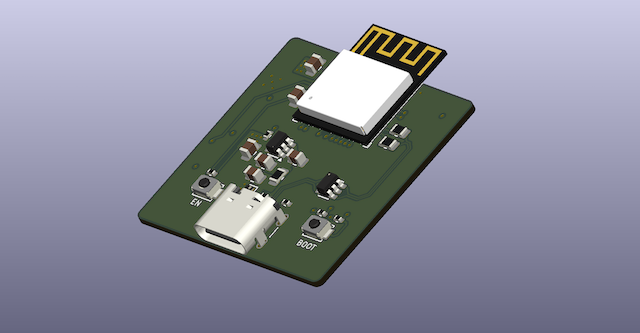

## PCB

## GPIO Reference

The following table maps the ESP32-C3 GPIOs to their corresponding signal names in the hardware design.

| GPIO   | Signal |
| ------ | ------ |
| GPIO0  | -      |
| GPIO1  | -      |
| GPIO2  | HIGH\* |
| GPIO3  | -      |
| GPIO4  | -      |
| GPIO5  | CS     |
| GPIO6  | MOSI   |
| GPIO7  | MISO   |
| GPIO10 | SCK    |
| GPIO18 | USB D- |
| GPIO19 | USB D+ |
| GPIO20 | SDA    |
| GPIO21 | SCL    |

\*Notice: GPIO2 is connected to 3.3 V through an external 10 kΩ pull-up resistor (R9), which can be removed if needed for a different GPIO configuration.

**Note:** Signal names identify the nets in the hardware design; they do not restrict how the GPIOs may be used in other projects. The CS, MOSI, MISO, and SCK signals are not individually labeled on the PCB silkscreen.
